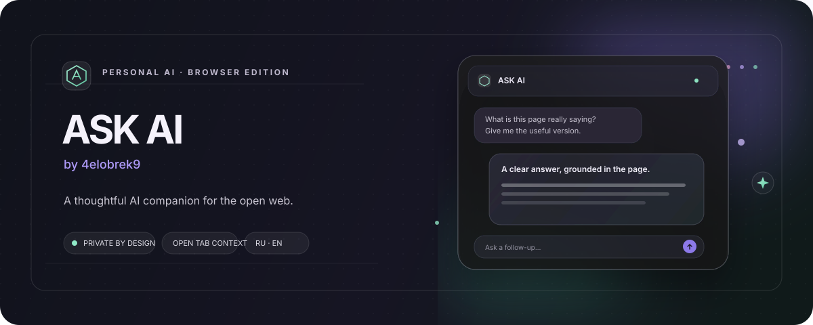

<div align="center">
  

  <br>

  **Ваш личный AI-компаньон для открытого интернета.**

  Читайте страницы, разбирайте видео и задавайте вопросы — не теряя контекст и нить мысли.

  <br>

  [Установка](#-установка) · [Возможности](#-возможности) · [Приватность](#-приватность-и-источники) · [Разработка](#-разработка)
</div>

<br>

## Интернет открыт. Контекст — тоже.

**ASK AI by 4elobrek9** — расширение Chrome, которое помогает разобраться в том, что уже открыто у вас в браузере. Спросите о статье обычными словами, попросите короткое резюме или уточните мысль — ответ строится с учётом выбранных вкладок и доступных субтитров видео.

Без обязательного API-ключа, без отдельного окна чата и без необходимости копировать страницу вручную. А если важнее всего локальность — подключите собственную модель через Ollama.

## ✨ Возможности

| Для ясности | Для вашего потока |
|:--|:--|
| **Вопросы по странице** — контекст добавляется к запросу незаметно. | **Несколько вкладок** — выберите страницы, которые важны именно сейчас. |
| **YouTube** — использует доступные субтитры или текст расшифровки. | **Продолжение беседы** — история и чаты сохраняются в браузере. |
| **Веб-поиск** — актуальные источники для подходящих вопросов. | **Режим без отвлечений** — потоковые ответы прямо в боковой панели. |
| **Подсказки-вопросы** — короткий путь от чтения к пониманию. | **RU / EN** — независимый язык интерфейса и ответов. |
| **Свободный провайдер** — начните без своей настройки сервера. | **Своя модель** — подключите Ollama и управляйте размещением данных. |

### ✳ Не просто чат поверх страницы

Откройте боковую панель, задайте вопрос и продолжайте читать. Нажмите **«Прочитать страницу»**, чтобы подготовить контекст и получить идеи для следующих вопросов. Выделили фрагмент? Вызовите **«Спросить»** через контекстное меню. Хотите переключить тему, язык или модель — настройки уже рядом.

## 🚀 Установка

1. Скачайте репозиторий: нажмите **Code → Download ZIP** и распакуйте архив.
2. Откройте `chrome://extensions` и включите **Режим разработчика**.
3. Нажмите **Загрузить распакованное расширение** и выберите папку `ask-any-llm` из распакованного репозитория.
4. Откройте ASK AI значком расширения или нажмите **Alt+Shift+A**.
5. При первом чтении страницы Chrome может запросить доступ к сайту. Если вкладка была открыта до установки, обновите её.

> **Наглядная установка:** сюда будет добавлена GIF-инструкция.

<br>

### Выберите, где будут рождаться ответы

**FREE · Pollinations** — провайдер по умолчанию, API-ключ не нужен. Расширение загружает список доступных моделей; состав и условия зависят от сервиса. Включённая автозамена помогает выбрать доступную модель, если выбранная временно не отвечает.

**LOCAL · Ollama** — укажите адрес сервера и установленную модель. По умолчанию это `http://localhost:11434` и `qwen2.5`. Для другой машины Chrome запросит разрешение на подключение. Сначала установите Ollama и нужную модель, например:

```sh
ollama pull qwen2.5
```

Для Pollinations отправляются ваши сообщения и выбранный контекст страниц. Для Ollama ответы формируются через ваш сервер; если включён веб-поиск, поисковые запросы для актуальной информации всё равно отправляются в Bing. Отключите поиск в настройках, если хотите использовать Ollama без него.

## 🫧 Приватность и источники

- История чатов хранится в локальном хранилище браузера.
- **FREE** использует внешний сервис Pollinations; его доступность и лимиты могут меняться.
- **LOCAL** отправляет запросы ответов вашей Ollama. Данные не покидают настроенную вами среду модели, если не включён поиск.
- Поиск в Bing включён по умолчанию для подходящих запросов о текущих фактах. Результаты помогают ответу, но не публикуются отдельным сообщением.
- Для YouTube доступность расшифровки зависит от видео и субтитров. Расширение не включает панель расшифровки автоматически.
- Ответы и цены могут быть неточными; перепроверяйте важные сведения по первоисточникам.

Язык интерфейса и **язык ответов** настраиваются отдельно. Можно, например, оставить меню на русском, а ответы и предлагаемые вопросы получать на английском.

## 🧭 Быстрый обзор настроек

| Настройка | Что меняет |
|:--|:--|
| **Провайдер и модель** | Выбирает Pollinations или вашу Ollama. |
| **Язык интерфейса** | Переводит меню и подписи расширения. |
| **Язык ответов** | Выбирает русский, английский или язык интерфейса. |
| **Веб-поиск** | Разрешает поиск актуальных сведений для подходящих запросов. |
| **Уточняющие вопросы** | Подсказывает, что спросить по странице или последнему ответу. |
| **Дополнительно** | Позволяет настроить системную инструкцию, контекст, таймаут и потоковый вывод. |

## 🛠 Разработка

```sh
npm install
npm test
```

Основной набор проверяет общие функции, фоновый процесс, извлечение текста и связку боковой панели с сервисным worker. Отдельная live-проверка обращается к настоящим провайдерам и требует сети:

```sh
npm run test:live
```

Исходники устанавливаемого расширения находятся в [`ask-any-llm/`](ask-any-llm/). Подробности работы сторонних сервисов и Ollama смотрите в их документации.

---

<div align="center">
  <sub>Сделано, чтобы читать меньше на бегу — и понимать больше.</sub>
</div>
